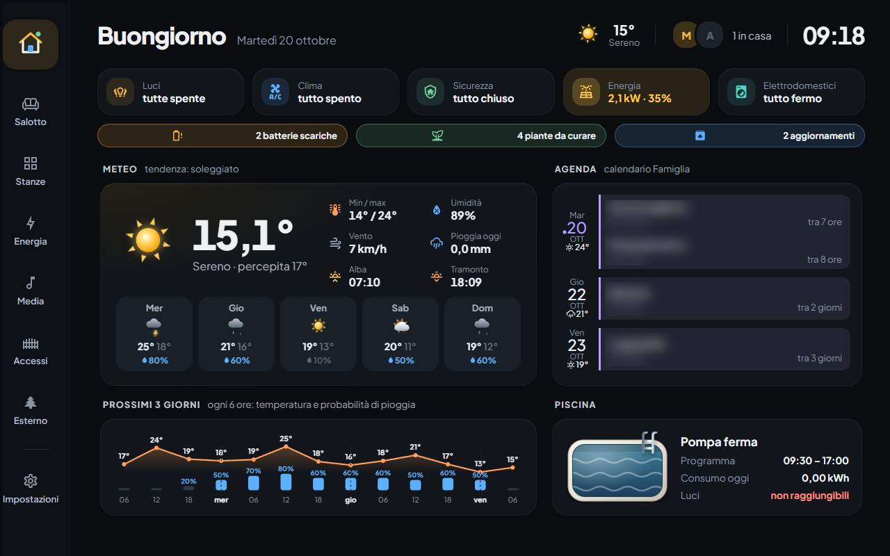
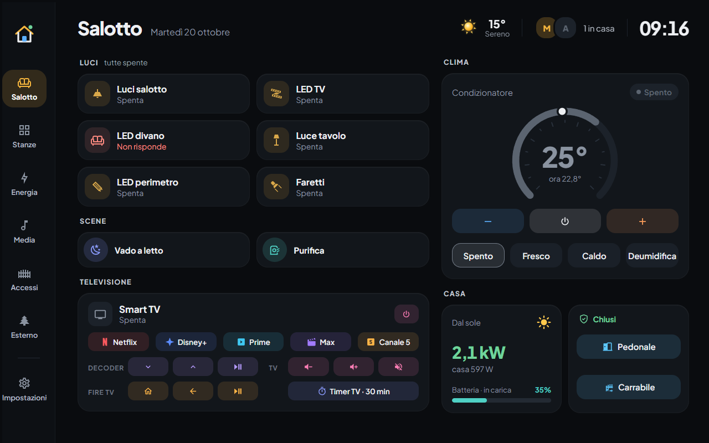
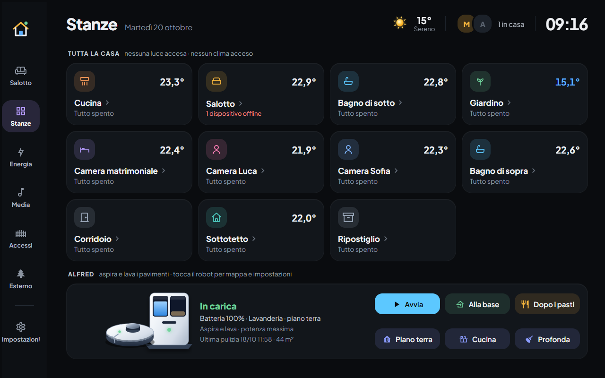
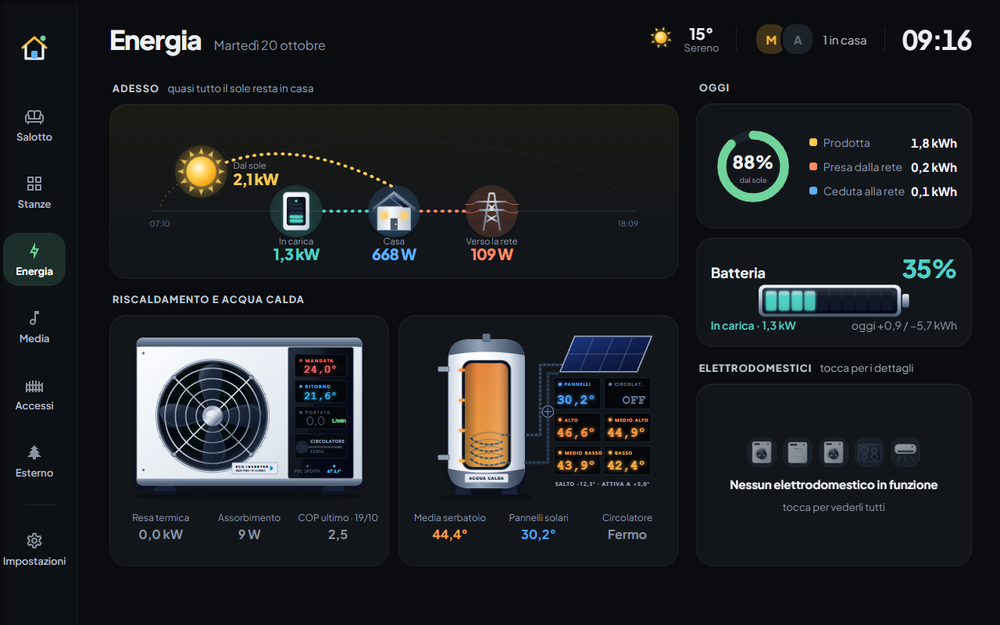
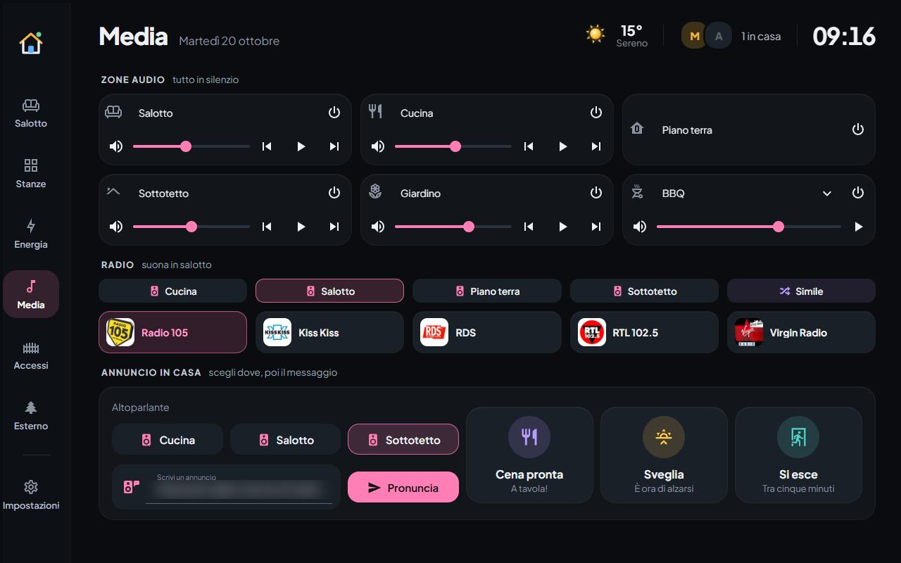
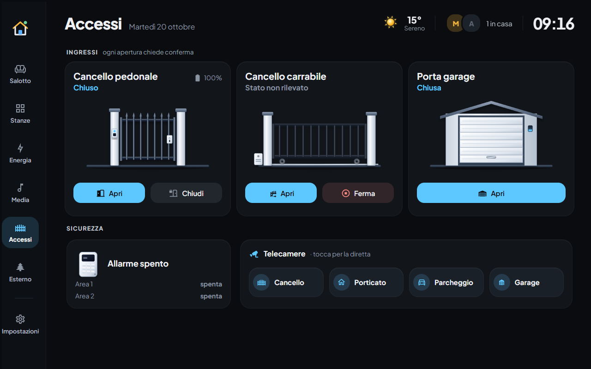
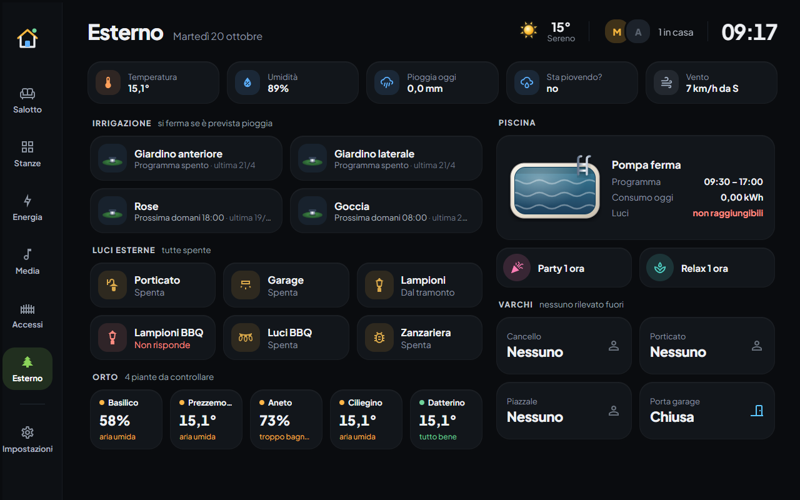
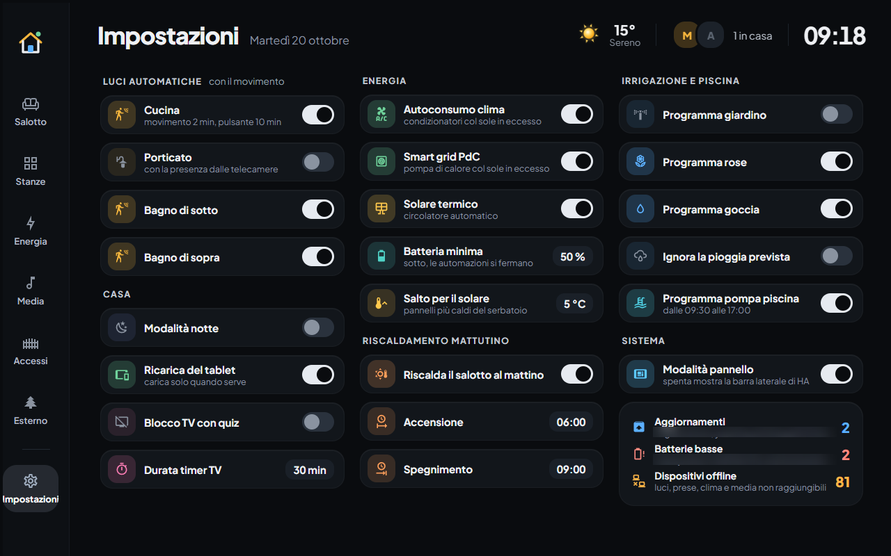

# Dashboard Tablet per Home Assistant

Dashboard a parete per un tablet da 1280×800 in orizzontale, montato in salotto. È scritta in YAML,
ha 8 viste e una ventina di popup, e usa uno stile "bento": tessere piatte su fondo quasi nero, con
colori diversi per luci, clima, energia, media e sicurezza.



> **Dati oscurati.** Nomi delle persone, indirizzi di rete e percorsi locali sono sostituiti con
> segnaposto (`person.marco`, `homeassistant.local`, ecc.). Nelle foto sono sfocati gli eventi del
> calendario e i nomi dei dispositivi. Le entità sono quelle di una casa reale: per usare la
> dashboard altrove vanno rimappate sulle proprie.

## Le viste

| | |
|---|---|
| **Casa**: la panoramica. Sintesi di luci, clima, sicurezza, energia ed elettrodomestici; avvisi (batterie, piante, aggiornamenti); meteo, agenda, previsioni a 3 giorni e piscina. |  |
| **Salotto**: luci, scene, televisione con app e telecomandi, condizionatore con quadrante, stato di casa. |  |
| **Stanze**: una tessera per stanza con temperatura e stato. Il tocco apre il popup della stanza con luci, clima e sensori. In basso c'è il robot aspirapolvere. |  |
| **Energia**: flusso istantaneo sole → batteria → casa → rete, bilancio del giorno, pompa di calore e accumulo dell'acqua calda con le sonde, elettrodomestici in funzione. |  |
| **Media**: zone audio, radio con la scelta della zona, annunci vocali in casa. |  |
| **Accessi**: cancelli e garage (ogni apertura chiede conferma), allarme, telecamere in diretta nei popup. |  |
| **Esterno**: meteo locale, irrigazione, luci esterne, orto con le sonde delle piante, piscina, sensori di presenza. |  |
| **Impostazioni**: interruttori delle automazioni (luci, energia, irrigazione, riscaldamento mattutino), modalità pannello e stato del sistema. |  |

## Come è fatta

Ogni vista è **una sola griglia CSS** (`custom:grid-layout`) con 15 colonne:

```
colonne: 1 barra (104px) | 2 spaziatore | 3..14 contenuto (12 colonne) | 15 margine
righe:   1 margine | 2 testata | 3 contenuto
```

La barra di navigazione (`rail.yaml`) e la testata (`testata.yaml`) sono figlie dirette della
griglia. Il contenuto sta nella riga 3, diviso in colonne di sezioni larghe da 1 a 12 dodicesimi.
Le righe seguono il contenuto e non l'altezza dello schermo, così le tessere non si allungano per
riempire lo spazio.

Tutte le tessere sono `custom:button-card` costruite da template comuni, raccolti in
`dashboards/tablet/modelli.yaml`. Per esempio: `sezione`, `stato_casa`, `avviso`, `luce_riga`,
`clima_quadrante`, `dato_stanza`. Gli stessi template servono sia le viste sia i popup, quindi lo
stile è uguale ovunque.

```
dashboards/
  tablet.yaml              # punto d'ingresso: viste, griglia, kiosk-mode
  tablet/
    modelli.yaml           # template button-card condivisi
    rail.yaml, testata.yaml
    vista-*.yaml           # una per vista
    popup-*.yaml           # contenuto dei popup browser_mod
    alfred.yaml            # robot aspirapolvere
themes/tablet_bento.yaml   # tema
www/tablet-fonts.js        # font Inter / JetBrains Mono e ritorno automatico alla panoramica
strumenti/                 # generatore delle stanze, anteprima, foto, validazione
docs/screenshot/
```

Alcuni comportamenti da sapere:

- **Kiosk.** `kiosk-mode` nasconde l'intestazione e la barra laterale di HA quando
  `input_boolean.kiosk_tablet` è acceso. Si spegne da *Impostazioni → Modalità pannello*.
- **Ritorno alla panoramica.** `www/tablet-fonts.js` riporta il pannello su *Casa* dopo 3 minuti
  senza tocchi e chiude un eventuale popup, ma solo con il kiosk acceso.
- **Popup.** Si aprono con `fire-dom-event` → `browser_mod.popup`, e il contenuto è incluso dai
  file `popup-*.yaml`.
- **Generati.** `vista-stanze.yaml` e i `popup-<stanza>.yaml` vengono scritti da
  `strumenti/genera-stanze.py` partendo da un'unica tabella `STANZE`. Per cambiarli si modifica lo
  script e lo si rilancia, non i file generati.

## Requisiti

Home Assistant 2026.x, più queste componenti da HACS:

- [button-card](https://github.com/custom-cards/button-card)
- [layout-card](https://github.com/thomasloven/lovelace-layout-card)
- [card-mod](https://github.com/thomasloven/lovelace-card-mod)
- [kiosk-mode](https://github.com/NemesisRE/kiosk-mode)
- [browser_mod](https://github.com/thomasloven/hass-browser_mod)
- [mini-graph-card](https://github.com/kalkih/mini-graph-card)
- [mini-media-player](https://github.com/kalkih/mini-media-player)
- [calendar-card-pro](https://github.com/alexpfau/calendar-card-pro)
- [WebRTC Camera](https://github.com/AlexxIT/WebRTC)
- [washing-machine-card](https://github.com/sionetta/wm_animated_ha_card): io uso una copia
  locale con la traduzione italiana e i tipi `induction` e `aircon`.

Le immagini delle radio stanno in `/config/www/radio/` e non sono nella repo: mettici le tue,
oppure cambia i percorsi in `vista-media.yaml`.

## Installazione

1. Copia `dashboards/` in `/config/dashboards/`, `themes/tablet_bento.yaml` nella cartella dei
   temi e `www/tablet-fonts.js` in `/config/www/`.
2. In `configuration.yaml`:

   ```yaml
   frontend:
     themes: !include_dir_merge_named themes
     extra_module_url:
       - /local/tablet-fonts.js

   lovelace:
     dashboards:
       dashboard-tablet:
         mode: yaml
         title: Tablet
         icon: mdi:tablet-dashboard
         show_in_sidebar: true
         filename: dashboards/tablet.yaml
   ```

3. Crea `input_boolean.kiosk_tablet` e rimappa le entità sulle tue. Conviene partire dalla tabella
   `STANZE` in `strumenti/genera-stanze.py` e dalla testata (`person.*`).

## Strumenti

Servono Node 22 o superiore (per il `WebSocket` nativo), Python con PyYAML e Pillow, e Chrome.
L'URL di HA si imposta in `HA_URL` (default `http://homeassistant.local:8123`). Il token di lunga
durata va in un file, indicato da `HA_TOKEN_FILE` (default `ha_token.txt`, già escluso da git).

```sh
cd strumenti
python genera-stanze.py                       # rigenera vista Stanze e popup (verifica le entità)
python build.py ../dashboards/tablet.yaml     # risolve gli !include → config.json
node push.mjs                                 # carica config.json nella dashboard "tablet-anteprima"
DASH=tablet-anteprima node shot.mjs casa energia   # foto a 1280×800 → casa.png, energia.png
node del.mjs                                  # cancella l'anteprima
node valida.mjs dashboard-tablet              # controlla che la dashboard live si carichi
```

Con l'anteprima puoi provare una modifica sul vero HA senza toccare il pannello a parete.

## Crediti

Questa dashboard non sarebbe esistita senza il lavoro di altri. Grazie a:

**Home Assistant e card della community**
- [Home Assistant](https://www.home-assistant.io/)
- [button-card](https://github.com/custom-cards/button-card) (custom-cards): su questa card è costruita
  quasi ogni tessera
- [layout-card](https://github.com/thomasloven/lovelace-layout-card),
  [card-mod](https://github.com/thomasloven/lovelace-card-mod) e
  [browser_mod](https://github.com/thomasloven/hass-browser_mod) di Thomas Lovén
- [kiosk-mode](https://github.com/NemesisRE/kiosk-mode) (NemesisRE)
- [mini-graph-card](https://github.com/kalkih/mini-graph-card) e
  [mini-media-player](https://github.com/kalkih/mini-media-player) di Karl Kihlström
- [calendar-card-pro](https://github.com/alexpfau/calendar-card-pro) (alexpfau)
- [WebRTC Camera](https://github.com/AlexxIT/WebRTC) e [go2rtc](https://github.com/AlexxIT/go2rtc)
  di Alexey Khit
- [Animated Washing Machine Card](https://github.com/sionetta/wm_animated_ha_card) (sionetta): le
  animazioni degli elettrodomestici, in stile Oikos

**Font e icone**
- [Inter](https://rsms.me/inter/) (Rasmus Andersson),
  [Plus Jakarta Sans](https://github.com/tokotype/PlusJakartaSans) (Tokotype) e
  [JetBrains Mono](https://www.jetbrains.com/lp/mono/): licenza SIL Open Font License, caricati da
  Google Fonts
- [Material Design Icons](https://pictogrammers.com/library/mdi/) (Pictogrammers)

**Integrazioni dietro le entità.** Le entità vengono da integrazioni ufficiali o della community:
[Frigate](https://frigate.video/) per la presenza dalle telecamere, Roborock, Netatmo, Shelly,
Android TV / Fire TV, Spotify, Plant e dispositivi Zigbee (Aqara e altri).

**Disegni e loghi.** Le illustrazioni SVG di cancelli, garage, pompa di calore, accumulo e meteo
sono originali di questo progetto. I loghi delle radio (`/local/radio/*.webp`) appartengono alle
rispettive emittenti e non sono inclusi nella repo.

Il design è stato sviluppato con [Claude Code](https://claude.com/claude-code).

## Licenza

[MIT](LICENSE).
